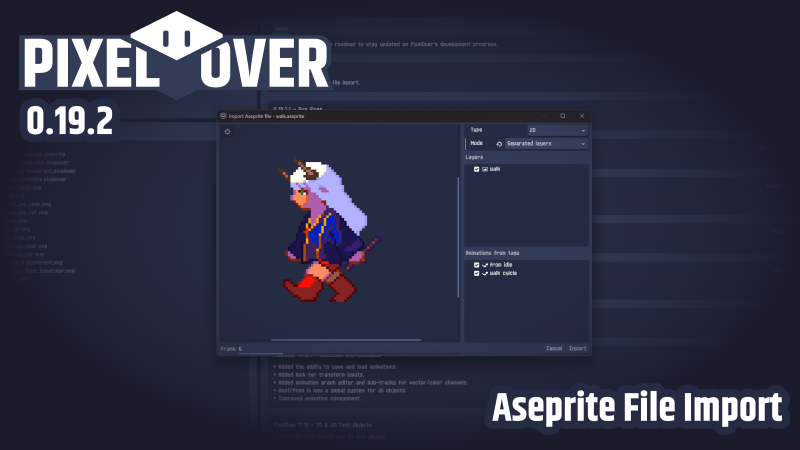
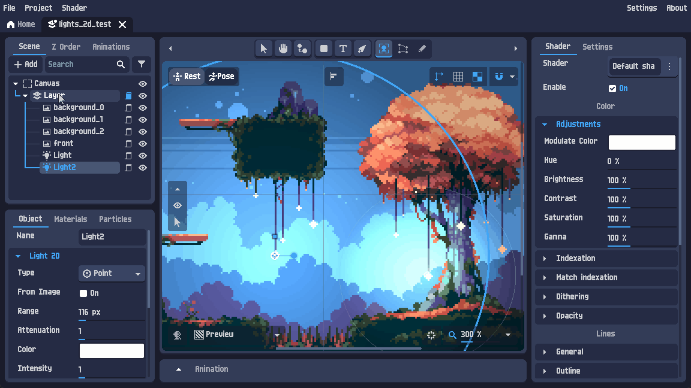
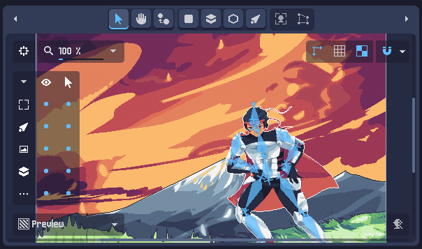

# PixelOver Gives Existing Artwork a Pixelated Performance

PixelOver turns existing images, animated artwork, and 3D models into pixel-art compositions and animation.
Build a consistent rendered style, animate the underlying objects, and check the resulting sprites at their actual game size.
The workflow below follows those decisions from the source artwork to a usable export.

[](https://pixelover-animation.github.io/PixelOver/)

## Establish the rendered look before building the motion

Choose a target character height or frame size before tuning fine detail.
A silhouette that reads at 128 pixels may need simplification at 32 pixels.
Compare the conversion at its intended display scale throughout the project.

PixelOver shaders provide real-time color adjustment, palette indexation, dithering, and line effects.
Indexation maps colors to a palette; dithering mixes nearby palette colors through a pattern.
Tune these separately so a detailed pattern does not hide an unclear shape.

| Source material | Conversion decision | Production constraint |
| --- | --- | --- |
| Painted character | Which shapes survive color reduction | Readable silhouette at the target height |
| Separate body-part images | Shared palette and outline treatment | Consistent joins during motion |
| Existing animated image | Stable color treatment across frames | Avoiding distracting color changes |
| Animated 3D character | Camera framing and pixel scale | Consistent bounds across poses and directions |

### Compare a controlled set of changes

Keep one baseline version of the shader.
Change the palette first, then compare dithering and line settings.
Use the same pose and background while judging each variation.

A transparent background is required for PixelOver's outside outline effect.
Review the contour against both a light and a dark surround.
An attractive still image can reveal noisy edges once an object starts rotating.

Pixelorama's related palette sources include [median_cut.gd](addons/gdgifexporter/quantization/median_cut.gd) and [uniform.gd](addons/gdgifexporter/quantization/uniform.gd).
Its GIF conversion path uses [converter.gd](addons/gdgifexporter/converter.gd).
The shaders [lookup_color.gdshader](addons/gdgifexporter/lookup_color.gdshader) and [lookup_similar.gdshader](addons/gdgifexporter/lookup_similar.gdshader) provide color-lookup references.

### Reuse the settings that define the style

PixelOver can save shader settings in a POSHADER file for reuse.
Name the saved look around its visual purpose rather than a temporary experiment number.
Recheck the result on another asset before treating it as a project-wide default.



## Give the rig enough artwork to reveal

For PixelOver bone animation, prepare the body parts as separate images.
Fill areas hidden behind neighboring pieces so a rotated arm does not expose an empty shoulder.
Keep the original whole drawing available as a visual reference.

The official rigging workflow creates bones and parents each image beneath the bone that should move it.
Check a single joint before building a complicated hierarchy.
Clear object names make it easier to identify the track you are changing.

### Keep setup edits separate from animated edits

PixelOver's Rest mode changes global default values.
Pose mode works with the active animation when a property has an animation track.
If that track is absent, a property change can still alter its rest value.

Before recording a pose, inspect the selected animation, current time, and relevant track.
Test a small rotation, move the cursor to another time, and confirm the result.
Keep an earlier project revision before changing the rig hierarchy.

- Begin with the main weight-bearing parts.
- Test the range of movement at shoulders, hips, and other joints.
- Look for gaps or overlapping outlines at the extreme poses.
- Compare the neutral pose with the intended strongest action pose.
- Add secondary motion after the main movement reads clearly.

### Judge the animation at its delivery timing

The timeline's interpolation and the exported frame sampling serve different purposes.
Play the motion normally, then inspect a few exported poses for abrupt pixel changes.
A smooth object transform can still produce an uneven silhouette at a small resolution.

Pixelorama's [frame.gd](addons/aimg_io/frame.gd) represents animation frames with durations.
Its [base_exporter.gd](addons/aimg_io/base_exporter.gd) defines a common animation-export interface.
Those references illustrate the distinction between frame content and playback timing.

## Keep every 3D direction inside a stable frame

For a 3D source, decide the viewing angle and character scale together.
Leave room for the largest pose, including an extended weapon, wing, or foot.
Review more than the front view before committing to a frame size.

PixelOver's eight-direction tutorial uses one row per direction and one column per frame.
It recommends orthogonal projection for a stable sprite scale.
The current view establishes the first direction, so record that orientation for the receiving game.

### Check a complete turn before exporting a long sequence

Compare front, side, and back views at the same apparent scale.
Look for accessories that vanish behind the body or extend outside the frame.
Keep the ground contact or another chosen anchor consistent across directions.



The sampling step for eight evenly spaced directions is 45 degrees.
Write down the direction order along with the sheet dimensions.
A correct row count alone does not tell the game which row faces the player.

Pixelorama's [RegionUnpacker.gd](addons/SmartSlicer/Classes/RegionUnpacker.gd) provides a region-detection reference.
Region detection and a fixed frame grid are different ways to describe image content.
For directional animation, retain the deliberate grid even when some cells contain large transparent areas.

### Display a known directional sheet in Godot

This Godot 4 script expects a Node2D with a Sprite2D child named Sprite2D.
Assign a 384-by-512 texture in the inspector: six columns and eight rows of 64-by-64 cells, without padding.
The example displays the first frame of the third direction row.

```gdscript
extends Node2D
@export var sheet: Texture2D
@onready var sprite: Sprite2D = $Sprite2D
func _ready() -> void:
    sprite.texture = sheet
    sprite.hframes = 6
    sprite.vframes = 8
    sprite.frame_coords = Vector2i(0, 2)
```

The row and column coordinates start at zero.
This selects one pose; a playback system must advance the column and choose the appropriate direction.
Use the exported layout information when the sheet contains margins or padding.

## Export the view and area you actually reviewed

Open Project > Export and choose the intended animation and output format.
PixelOver currently documents PNG images or sheets, GIF animation, and Aseprite project export.
Export requires the paid version; the demo can save projects for later use.

### Keep bounds, layers, and timing explicit

Check whether the output combines layers or exports them separately.
Confirm the export area, final dimensions, animation selection, and speed settings.
Use a fixed area or the documented size-alignment controls when frame bounds would otherwise vary.

For a sprite sheet, record the cell dimensions, margin, padding, and reading order.
PixelOver can also export JSON data describing the sheet.
Keep that metadata with the image when another tool relies on its frame rectangles or durations.

The shader preview is only one part of the export decision.
A different view, background, or export region can produce a different deliverable.
Reopen a small exported sample before producing a large set of animations.

### Make a separate GIF preview from numbered images

For a downstream comparison, prepare equally sized PNGs named pose-000.png, pose-001.png, and onward in a frames directory.
These FFmpeg commands build a shared palette and encode the sequence at twelve frames per second.
Choose unused names for both outputs.

```sh
ffmpeg -n -framerate 12 -start_number 0 -i "frames/pose-%03d.png" -vf palettegen -frames:v 1 "preview-palette.png"
ffmpeg -n -framerate 12 -start_number 0 -i "frames/pose-%03d.png" -i "preview-palette.png" -lavfi paletteuse -loop 0 "motion-review.gif"
```

The preview uses a uniform frame rate and repeats indefinitely.
Keep the numbered source frames and the editable PixelOver project for later changes.
Inspect transparent edges and palette changes in the viewer that will receive the GIF.



### Related animation-format sources

Pixelorama's GIF path includes [exporter.gd](addons/gdgifexporter/exporter.gd), [importer.gd](addons/gdgifexporter/importer.gd), and [gifdatatypes.gd](addons/gdgifexporter/gifdatatypes.gd).
Its binary helpers include [little_endian.gd](addons/gdgifexporter/little_endian.gd), [lzw.gd](addons/gdgifexporter/gif-lzw/lzw.gd), and [lsbbitpacker.gd](addons/gdgifexporter/gif-lzw/lsbbitpacker.gd).

For a separate APNG implementation reference, the collection includes [apng_stream.gd](addons/aimg_io/apng_stream.gd),
[apng_importer.gd](addons/aimg_io/apng_importer.gd), [apng_exporter.gd](addons/aimg_io/apng_exporter.gd), and [crc32.gd](addons/aimg_io/crc32.gd).
These files concern Pixelorama's animation-format modules; the PixelOver output choices are listed above.

## Keep the workspace clear enough to reproduce a result

Record the project version, source asset, shader settings, animation, and export choices.
When a result looks wrong, change one of those factors at a time.
A compact example project can make an issue easier to explain than screenshots alone.

### Describe the action as well as the visible symptom

For a PixelOver tutorial, identify the object being edited and whether the application is in Rest or Pose mode.
For PixelOver shaders, include the palette and effect settings that make the difference visible.
For a motion problem, identify the first frame or time where the expected and actual results diverge.

Keep interface preferences separate from project data.
A rearranged panel or different shortcut can change how a workflow is performed without changing the artwork itself.
Use named controls in instructions when key bindings may differ.

Pixelorama's shortcut references include [Keychain.gd](addons/keychain/Keychain.gd) and [ShortcutProfile.gd](addons/keychain/ShortcutProfile.gd).
The editing controls are represented by [ShortcutSelectorDialog.gd](addons/keychain/ShortcutSelectorDialog.gd) and [ShortcutEdit.gd](addons/keychain/ShortcutEdit.gd).
[default.tres](addons/keychain/profiles/default.tres) defines its default shortcut profile resource.

### Understand panel and project references

Pixelorama's dock layout is represented by [dockable_container.gd](addons/dockable_container/dockable_container.gd) and [layout.gd](addons/dockable_container/layout.gd).
[floating_window.gd](addons/dockable_container/floating_window.gd) handles floating-window behavior.
[split_handle.gd](addons/dockable_container/split_handle.gd) supplies splitter controls.

The [project.godot](project.godot) file is Pixelorama's Godot project configuration.
[CHANGELOG.md](CHANGELOG.md) records that project's changes.
The add-on [README.md](addons/README.md) identifies bundled module origins and licensing references.

For application behavior, use the official [shader guide](https://docs.pixelover.io/manual/shader/),
[animation guide](https://docs.pixelover.io/manual/animation/), and [export guide](https://docs.pixelover.io/manual/export/).

## Related Search Terms

PixelOver Animation, PixelOver, pixelover shaders, pixelover bone animation, pixelover tutorial, pixel-art, animation, sprites, spritesheet, sprite-animation, graphics, game-development, godot-engine, vector-graphics, art
